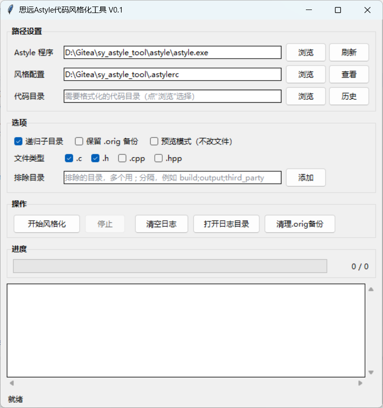
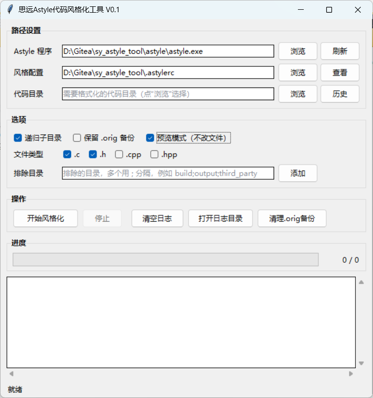
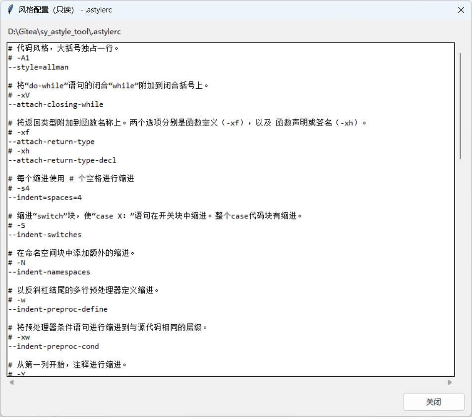

# 思远 Astyle 代码风格化工具（sy_astyle_tool）

一个 Windows 桌面小工具：把 Artistic Style（astyle）的**单文件格式化**扩展成**整目录批量格式化**，
逐文件显示处理结果，并提供预览、备份、过滤和日志等能力。

- 纯 Python 标准库 + tkinter，**无需安装任何第三方包**
- 随程序附带 `astyle.exe`（Artistic Style **3.6.20**）和默认风格配置 `.astylerc`
- 支持递归目录、扩展名筛选、排除目录、`.orig` 备份、预览模式、停止、历史目录、日志落盘

---

## 界面预览

主界面：




预览模式（对当前代码目录的真实预览结果，不修改任何文件）：




风格配置只读查看窗口（“查看”按钮）：



---

## 功能特性

| 功能 | 说明 |
|---|---|
| 整目录批量 | 选择一个代码根目录，串行调用 astyle 处理其中所有匹配文件 |
| 风格由配置决定 | 只传 `--options=<.astylerc>` 与目标文件，不额外施加任何风格参数，格式结果完全来自配置文件 |
| 精确结果判定 | 用格式化前后的 SHA-256 对比区分“已格式化 / 无变化”，不依赖 astyle 输出 |
| 预览模式 | 在临时副本上真实格式化并比较，原文件零改动 |
| `.orig` 备份 | 备份由程序自己生成，只对**实际发生修改**的文件保留 |
| 停止 | 处理完当前文件后停止，不强行杀进程 |
| 日志 | 界面彩色日志 + `logs\astyle_YYYYMMDD_HHMMSS.log` 文件日志（UTF-8 带 BOM） |
| 历史目录 | 记住最近 10 个使用过的代码目录，可快速切换 |
| 参数记忆 | 关闭窗口时写入 `settings.ini`，下次启动自动恢复 |

---

## 运行环境

- Windows 10 / 11（程序使用 `os.startfile`、`CREATE_NO_WINDOW` 等 Windows 特性）
- Python 3.10.x（开发与验证环境；使用官方安装包时自带 tkinter）
- 不需要 `pip install`，只依赖 Python 标准库：`tkinter` / `subprocess` / `threading` / `queue` / `configparser` 等
- 依赖清单见 `requirements.txt`：无第三方运行时依赖，仅含打包工具 PyInstaller（开发/打包阶段使用）
- 自带的 `astyle\astyle.exe`（Artistic Style 3.6.20）可直接使用

---

## 快速开始

```powershell
# 1. 获取代码（或直接解压压缩包）
git clone <仓库地址> sy_astyle_tool
cd sy_astyle_tool

# 2. 启动（无需安装依赖）
python main.py
```

也可以使用打包好的免安装版本（无需 Python 环境），打包方法见 [docs/打包说明.md](docs/打包说明.md)。

启动后窗口标题为 `思远Astyle代码风格化工具`，三个路径框默认值为：

- Astyle 程序：`<程序目录>\astyle\astyle.exe`
- 风格配置：`<程序目录>\.astylerc`
- 代码目录：空（需要手动选择）

首次使用建议先勾选**预览模式**跑一遍，确认结果符合预期后再正式格式化。

---

## 使用说明

### 1. 设置路径

| 控件 | 说明 |
|---|---|
| Astyle 程序 | `astyle.exe` 的完整路径，可手动输入/粘贴，也可点“浏览”选择 |
| 刷新 | 把“Astyle 程序”和“风格配置”重置为随程序附带的默认路径，并执行 `astyle --version` 验证可用性，版本号显示在状态栏和日志中；若当前填写的内容与默认路径不同，会先弹窗确认再覆盖 |
| 风格配置 | `.astylerc` 的路径，可点“浏览”选择、点“查看”以只读方式浏览全文 |
| 代码目录 | 需要批量格式化的根目录，可点“浏览”选择，或点“历史”从最近使用过的目录中切换 |

> “查看”只读显示 `.astylerc`，**不支持在工具内编辑**；修改风格请用外部编辑器改文件后重新运行。

### 2. 选择选项

| 选项 | 默认 | 说明 |
|---|---|---|
| 递归子目录 | 勾选 | 勾选时处理根目录及所有子目录；取消后只处理根目录第一层文件 |
| 保留 .orig 备份 | 不勾选 | 勾选后，格式化前把文件复制为 `<文件名>.orig`；只有真正被修改的文件才保留备份 |
| 预览模式（不改文件） | 不勾选 | 只报告“将会修改 / 无需修改”，不写源文件、不生成 `.orig` |
| 文件类型 | `.c` `.h` | 可选 `.c` `.h` `.cpp` `.hpp`，至少勾选一种 |
| 排除目录 | `.git` | 多个用 `;` 分隔，如 `build;output;third_party`，也可点“添加”选择目录 |

排除目录的匹配规则：

- 只写目录名（如 `build`）时，匹配**任意层级**下同名目录；
- 写相对路径（如 `application\test`）或绝对路径时，按路径前缀匹配整棵子树；
- 通过“添加”按钮选择且位于代码目录内时，自动保存为相对路径。

### 3. 开始风格化

点击“开始风格化”后依次执行：

1. **参数校验**：检查 astyle.exe、`.astylerc`、代码目录是否存在，以及是否勾选了文件类型；任一失败会弹窗提示并中止。
2. **扫描文件**：按扩展名筛选、跳过排除目录、按路径升序排序；没有找到文件时提示并中止。
3. **确认**：非预览模式会弹出确认框，显示文件数量、目录、递归与备份状态；预览模式不弹确认框。
4. **逐文件处理**：后台线程串行调用 astyle，每处理完一个文件就刷新一行日志和进度。
5. **汇总**：状态栏与日志末行给出总数、已格式化/无变化/失败数量与用时；有失败或预览结束时弹窗汇总。

处理过程中：

- “开始风格化”“刷新”“清理.orig备份”会被禁用，避免重复执行；
- 点“停止”会置中断标志，**当前文件处理完成后**停止；
- 运行中关闭窗口会先确认，再停止并退出。

### 4. 查看结果

每行日志格式为：

```
[HH:MM:SS] [STATUS] 相对路径  说明  耗时s
```

| 状态 | 颜色 | 含义 |
|---|---|---|
| `OK` | 绿色 | 文件内容已改变（预览模式为“将会修改”） |
| `SKIP` | 灰色 | 格式化前后内容相同（预览模式为“无需修改”） |
| `FAIL` | 红色 | astyle 退出码非 0、超时、无法启动、备份/读写失败等 |
| `INFO` | 默认色 | 扫描结果、日志路径、开始/结束等提示 |

> `.astylerc` 中带有 `--quiet`，astyle 通常不输出文字，因此失败详情可能只有“退出码 N”；具体原因（如文件只读、被占用）可结合日志中的说明判断。

底部状态栏在完成后显示：

```
状态：完成    处理：80    已改：26    无变化：53    失败：1    用时：4.62s
```

### 5. 日志与备份

- 每次运行（含预览模式）都会新建日志文件：`<程序目录>\logs\astyle_YYYYMMDD_HHMMSS.log`（UTF-8 带 BOM，记事本可直接打开）；
- 同一秒内重复开始会追加 `_2`、`_3` 后缀，不覆盖上一次日志；
- “清空日志”只清空界面显示，**不会删除日志文件**；“打开日志目录”用系统资源管理器打开 `logs`；
- 勾选备份时，`.orig` 恒等于本次格式化前的内容；若本次格式化无变化，程序会自动删除刚生成的 `.orig`，避免堆积；
- “清理.orig备份”会删除代码目录下的所有 `*.orig`，范围跟随“递归子目录”勾选；删除前弹出确认框，删除结果逐条写入日志。

---

## 格式化命令

工具对每个文件执行一次 astyle（`--suffix=none` 用于禁止 astyle 自己生成备份，不影响风格）：

```text
"<程序目录>\astyle\astyle.exe" --options="<程序目录>\.astylerc" --suffix=none 目标文件
```

风格完全来自 `.astylerc`，工具不追加任何会改变风格的参数；备份、预览和结果判定均由本程序自行实现。

---

## 配置持久化（settings.ini）

关闭窗口时写入 `<程序目录>\settings.ini`（UTF-8 明文），下次启动自动恢复：

```ini
[General]
exe = D:\Gitea\sy_astyle_tool\astyle\astyle.exe
rc = D:\Gitea\sy_astyle_tool\.astylerc
root = 
recursive = true
backup = false
dry_run = false
exts = .c,.h
excludes = .git
geometry = 610x620+591+152
```

- `history` 为 JSON 数组，最近使用的目录在前，最多 10 条；菜单中只显示仍然存在的目录；
- 旧版（Qt 时期）写下的带引号值、双写反斜杠在读取时已做兼容还原；
- `settings.ini` 与 `logs\` 已在 `.gitignore` 中忽略，不会提交到仓库。

---

## 项目结构

```text
sy_astyle_tool/
├── main.py                 # 入口 + 全部业务逻辑（扫描、调用 astyle、备份、日志、控制器）
├── ui_main.py              # 界面层（tkinter 控件、界面原语、settings.ini 读写）
├── .astylerc               # 默认代码风格配置（可在外部编辑）
├── astyle/
│   ├── astyle.exe          # 随程序附带的 Artistic Style 3.6.20
│   ├── file/               # astyle 官方风格示例（allman/google/llvm 等 .ini）
│   └── doc/                # astyle 官方文档
├── docs/                   # 文档（需求说明书、打包说明、配图）
├── logs/                   # 运行时自动生成的日志目录
├── settings.ini            # 运行时自动生成的界面配置
└── README.md
```

### 代码分层约定

- `ui_main.py` 只负责“看得见的部分”：搭控件、提供界面原语（选目录、写日志、弹窗、读写设置），**不出现任何 `command=` / `protocol()` 绑定**；
- `main.py` 的 `AppController._connect_signals()` 是**唯一的命令/事件注册点**，按钮与菜单的行为都在控制器里；
- 后台任务 `FormatWorker` 运行在 `threading.Thread` 中，只往 `queue.Queue` 投递事件；主线程通过 `after(60ms)` 轮询刷新界面，工作线程不直接操作 tk 控件；
- 新增功能时：在 `ui_main.py` 创建控件或界面原语，在 `main.py` 绑定命令并实现业务逻辑。

---

## 常见问题

**Q：为什么全部显示“无变化”？**
A：文件本身已经符合 `.astylerc` 的规则，astyle 没有改动内容，属于正常结果。想先确认会改哪些文件，可勾选“预览模式”。

**Q：格式化后想撤销怎么办？**
A：勾选“保留 .orig 备份”时，被修改的文件旁边会保留格式化前的 `.orig`，手工改回即可；备份功能默认关闭，建议正式处理前先提交或备份代码。

**Q：预览模式为什么没有生成 `.orig`？**
A：预览模式只操作临时副本，不写源文件，也不做备份。

**Q：为什么 `.orig` 数量比处理文件数少？**
A：无变化的文件会自动删除刚生成的 `.orig`，只有真正被修改的文件保留备份。

**Q：能否在工具里编辑 `.astylerc`？**
A：不能。“查看”为只读窗口，风格规则请用外部编辑器修改 `.astylerc`，保存后直接重新运行即可。

**Q：支持中文路径、带空格或 `&` 的路径吗？**
A：支持。全程使用 `pathlib` + `subprocess` 参数列表，不经过 shell 拼接。

**Q：astyle 卡住会不会一直等？**
A：单文件超时上限为 60 秒，超时记为 `FAIL` 并继续处理下一个文件。

**Q：会覆盖 `.orig` 吗？**
A：会。勾选备份时，每次处理前都覆盖为本次格式化前的内容，因此 `.orig` 始终对应“最近一次修改前”的文件。

---

## 已知限制

- 仅支持选择一个代码根目录（递归可覆盖其子目录）；
- 串行处理，不提供多进程并发；
- 不提供格式化前后 diff 预览，也不提供“一键还原”；
- 打包发布采用 PyInstaller 目录模式（见 `docs/打包说明.md`），暂不提供单文件 exe 与安装程序；
- tkinter 原生不支持文件拖放，路径需输入、粘贴或通过“浏览”选择。

---

## 许可

- 本项目代码遵循 [MIT License](LICENSE)；
- 随程序附带的 Artistic Style 3.6.20 遵循其自身许可，详见 [astyle/LICENSE.md](astyle/LICENSE.md)；
- 使用说明可参考 `astyle\doc\astyle.html` 或在界面中查看 `.astylerc` 注释。
